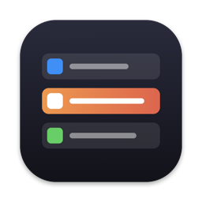

<p align="center"></p>

# CmdTab

A window switcher for macOS that replaces the native ⌘⇥ with a vertical list of **windows** (not apps), each shown as `App - Window title` — similar to AltTab's "Titles" style.

## Features

- Lists every window of every regular app, including windows on other Spaces, minimized windows and hidden apps
- Most-recently-used order; minimized/hidden windows at the bottom, windowless apps last
- Status icons per row: hidden, minimized, fullscreen, and the Space number (when you have more than one Space)
- Brings the exact window to front, un-minimizing / un-hiding it and switching Spaces as needed
- Quick ⌘⇥ taps switch instantly without flashing the UI
- Runs as a menu bar app (no Dock icon)

## Shortcuts

| Keys | Action |
| --- | --- |
| ⌘⇥ / ⌘⇧⇥ | Open the switcher, select next / previous window |
| Tab, ⇧Tab, ↑ ↓ | Move selection (while ⌘ is held) |
| Release ⌘, Return, Space, click | Switch to the selected window |
| Esc | Cancel |
| W / M / H / Q | Close window / minimize window / hide app / quit app |

## Requirements

- macOS 14+
- Xcode and [XcodeGen](https://github.com/yonaskolb/XcodeGen) (`brew install xcodegen`)
- **Accessibility** permission (System Settings → Privacy & Security → Accessibility). CmdTab prompts for it on first launch and starts working as soon as it's granted.

Quit other ⌘⇥ replacements (e.g. AltTab) first — only one app can own the shortcut.

## Build & run

The Xcode project is generated from `project.yml` and not checked in. Re-run `xcodegen generate` whenever you add/remove files or change `project.yml`.

### Debug build

```sh
xcodegen generate
xcodebuild -project CmdTab.xcodeproj -scheme CmdTab -derivedDataPath build build
open build/Build/Products/Debug/CmdTab.app
```

The app is ad-hoc signed, so macOS may drop the Accessibility grant after a rebuild. If ⌘⇥ stops responding, remove CmdTab from the Accessibility list and add it again.

### Release build

```sh
xcodegen generate
xcodebuild -project CmdTab.xcodeproj -scheme CmdTab -configuration Release -derivedDataPath build clean build
```

The app ends up in `build/Build/Products/Release/CmdTab.app` (Apple silicon, ~1 MB). Install it:

```sh
osascript -e 'quit app "CmdTab"' 2>/dev/null
ditto build/Build/Products/Release/CmdTab.app /Applications/CmdTab.app
open /Applications/CmdTab.app
```

To start it automatically, add it under System Settings → General → Login Items.

#### Stable signing (recommended)

By default the build is ad-hoc signed, and every rebuild looks like a new app to macOS, so the Accessibility permission has to be granted again. Signing with your Apple Development certificate keeps the identity stable across builds:

```sh
xcodebuild -project CmdTab.xcodeproj -scheme CmdTab -configuration Release -derivedDataPath build \
  CODE_SIGN_IDENTITY="Apple Development" DEVELOPMENT_TEAM=<YOUR_TEAM_ID> clean build
```

Find your team ID with `security find-identity -v -p codesigning` (the ID in parentheses after the name of an "Apple Distribution" certificate, or under Membership on developer.apple.com).

#### Sharing with other Macs

Zip the app with `ditto` (keeps signatures and extended attributes intact):

```sh
ditto -c -k --keepParent build/Build/Products/Release/CmdTab.app CmdTab.zip
```

An ad-hoc or Apple Development–signed app is blocked by Gatekeeper on other Macs. The recipient has to right-click → Open, or run `xattr -dr com.apple.quarantine /Applications/CmdTab.app`.

To distribute without that warning you need a **Developer ID Application** certificate (paid Apple Developer Program), the hardened runtime, and notarization. Untested sketch:

```sh
xcodebuild -project CmdTab.xcodeproj -scheme CmdTab -configuration Release -derivedDataPath build \
  CODE_SIGN_IDENTITY="Developer ID Application" DEVELOPMENT_TEAM=<YOUR_TEAM_ID> \
  ENABLE_HARDENED_RUNTIME=YES OTHER_CODE_SIGN_FLAGS=--timestamp clean build
ditto -c -k --keepParent build/Build/Products/Release/CmdTab.app CmdTab.zip
xcrun notarytool submit CmdTab.zip --keychain-profile <PROFILE> --wait   # set up with `xcrun notarytool store-credentials`
xcrun stapler staple build/Build/Products/Release/CmdTab.app
ditto -c -k --keepParent build/Build/Products/Release/CmdTab.app CmdTab.zip   # re-zip the stapled app
```

## How it works

CmdTab uses the same private macOS APIs as AltTab (resolved at runtime via `dlsym`):

| File | Responsibility |
| --- | --- |
| `KeyboardInterceptor.swift` | Disables the Dock's ⌘⇥ via `CGSSetSymbolicHotKeyEnabled` and handles keys with a `CGEventTap`; releasing ⌘ commits the selection |
| `WindowStore.swift` | Enumerates windows via the Accessibility API, finds windows on other Spaces by brute-forcing `_AXUIElementCreateWithRemoteToken`, tracks MRU order with `AXObserver` |
| `PrivateAPIs.swift` | SkyLight / HIServices bindings: window IDs, Space lookup, and focusing a specific window via `_SLPSSetFrontProcessWithOptions` + `SLPSPostEventRecordTo` |
| `SwitcherView.swift` | SwiftUI list UI |
| `SwitcherController.swift` | Ties it together: non-activating panel, selection, window actions |

The native ⌘⇥ is restored when CmdTab quits, including on Ctrl-C / `kill`. If CmdTab crashes and ⌘⇥ stays dead, launch and quit CmdTab once, or log out and back in.
